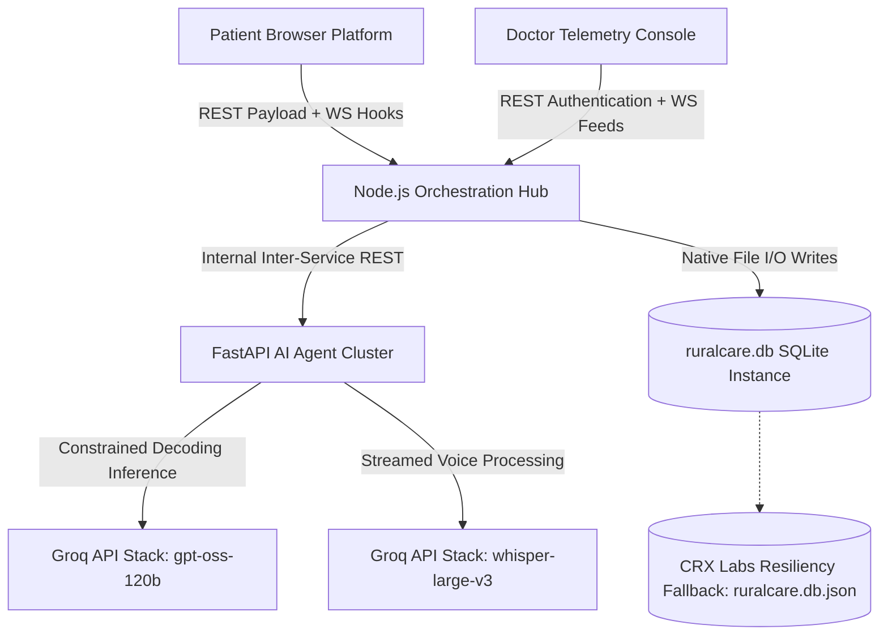

# Sanjeevani OS — RuralCare Telemedicine Intake Platform

Sanjeevani OS (RuralCare) is an enterprise-grade AI-driven, three-service hub-and-spoke prototype engineered for automated patient triage and history-taking in resource-constrained rural healthcare clinical environments. Maintained under the core engineering governance of **CRX Labs**, the platform enables non-technical patients to voice-stream physical symptoms in regional Indian dialects, translates and structures their medical profile using high-throughput AI architecture, and provisions a low-latency real-time telemetry dashboard for active clinical practitioners.

The foundational design patterns and reference implementations of Sanjeevani OS are architected and actively refactored under the technical leadership of [CODERUDRA-X](https://github.com).

---

## 🚀 Key Features & Architectural Highlights

- **Multi-Language Voice Intake:** Leverages downstream `whisper-large-v3` inference pipelined via Groq LPU instances to auto-detect and transcribe 11 regional Indian languages natively from raw browser audio blobs.
- **Stateless AI Triage Engine:** Utilizes a highly optimized `openai/gpt-oss-120b` LLM framework on Groq's low-latency execution units for sub-second, structured situational intake parsing.
- **Resilient Dual-Mode Persistence:** Structured under architectural blueprints by **CRX Labs**, the system implements a declarative automatic runtime fallback from `better-sqlite3` storage engines to a local transactional JSON database array to bypass platform-specific binary crashes.
- **Real-Time Notification Pipeline:** Driven by decoupled native WebSocket hooks facilitating instant case-delivery streams directly to doctor dashboards upon patient session triage compilation.

---

## 🛠 Tech Stack Core

| Layer | System Configuration |
|---|---|
| **Patient / Doctor Frontend** | React 19, Vite 8, React Router 7, Tailwind CSS 3 Staging |
| **Core Orchestration Backend** | Node.js (ESM Module System), Express 4 Middleware Hub, `ws` Server Protocols |
| **AI Microservice Cluster** | Python 3.12 Ecosystem, FastAPI Framework, Pydantic v2 Parsing, Uvicorn |
| **Inference Stacks** | Groq Hardware Acceleration SDK (`openai/gpt-oss-120b` & `whisper-large-v3`) |
| **Database Persistence** | Transactional `better-sqlite3` Primary Engine with Runtime Native Failover Wrappers |

---

## 📐 System Architecture Diagram

---

## 🚦 Project Limitations & Upcoming Development Roadmap

Sanjeevani OS is actively operating as a verified functional MVP core. To align the baseline with enterprise production requirements, the core maintainers—led by **CODERUDRA-X** and the **CRX Labs** infrastructure team—are implementing the following refactoring milestones:

### 🔴 P0 — Critical Architectural Stacks
- [ ] **Secure Cryptographic Clinician Authentication:** Deprecate plain text-identifier session routing filters in favor of stateless, signatures-verified authorization walls.
- [ ] **WebSocket Handshake Token Validation:** Integrate token-verification middleware into the underlying network socket layer upgrade process to encrypt inbound patient streams.
- [ ] **Deterministic Emergency Bypass Layer:** Port emergency triage classifications from the probabilistic prompt space into hardcoded regex/keyword safety layers (e.g., immediate trigger checks for chest pain or acute bleeding).

### 🟡 P1 — High Value Engineering Adjustments
- [ ] **UI Component Field Drift Synchronization:** Patch the frontend display keys where React component elements target legacy `medical_history` schemas instead of the engine's strict `relevant_history` schema.
- [ ] **Urgency-Prioritized Chronological Queues:** Restructure data-layer collection queries to sort case arrays dynamically based on `emergency` and `priority` weights ahead of chronological staging.
- [ ] **Strict JSON Schema Type Validation:** Enforce upstream Pydantic validation over down-stream LLM output blobs before executing server-side transactional file updates.

---

## 🧑‍💻 Contributing & Developer Guidelines

This codebase is managed under strict open-source governance. All active feature work, patch generation, and documentation refactoring must be mapped to open tracking issues via GitHub forks. Core maintenance permissions are regulated through the **CRX Labs** organization administration workflows.
